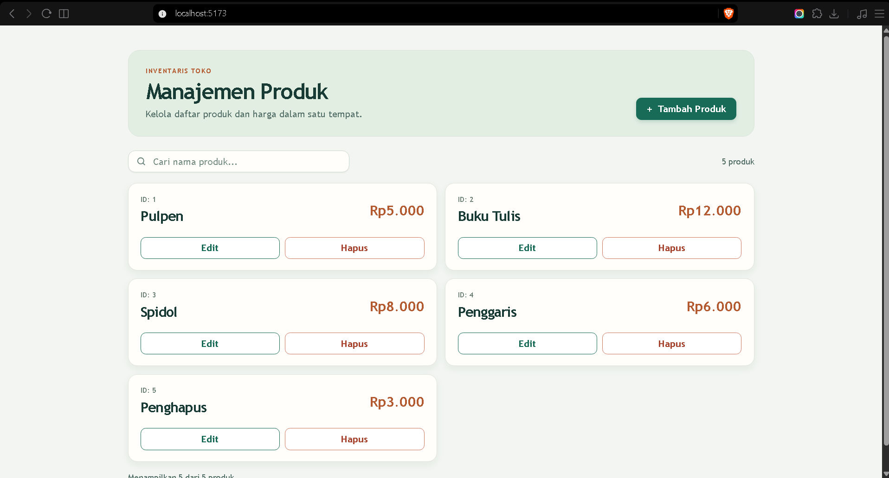
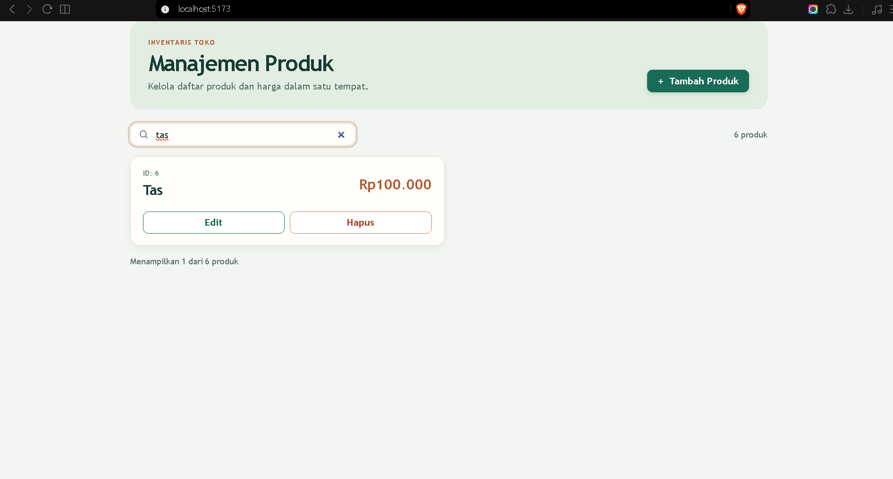
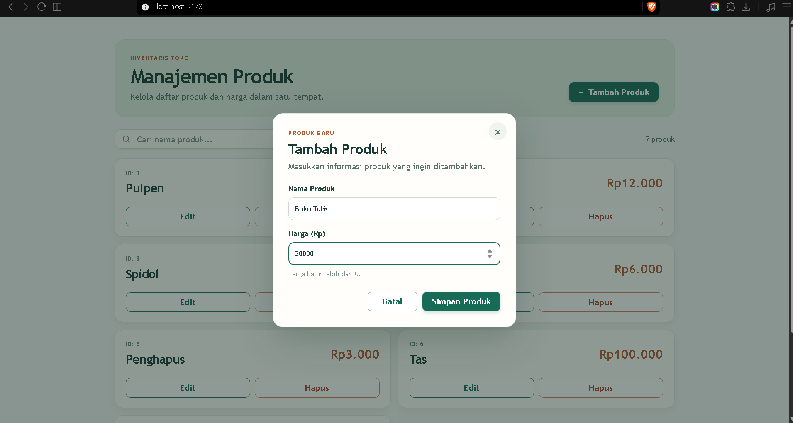
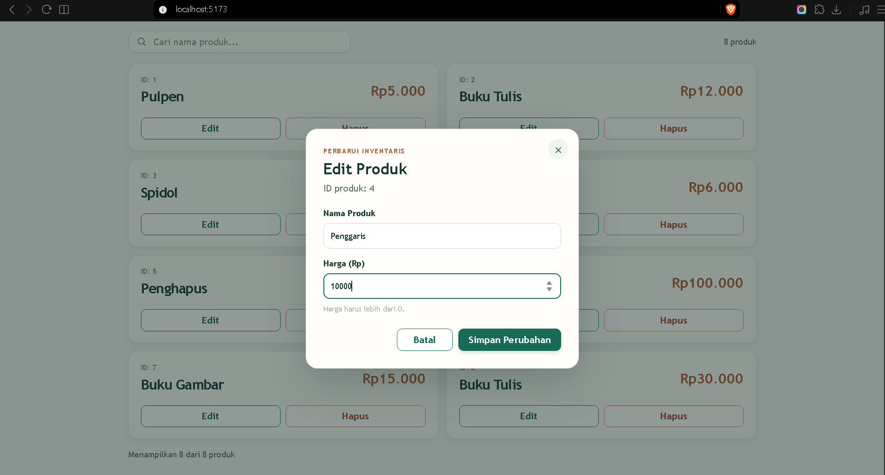
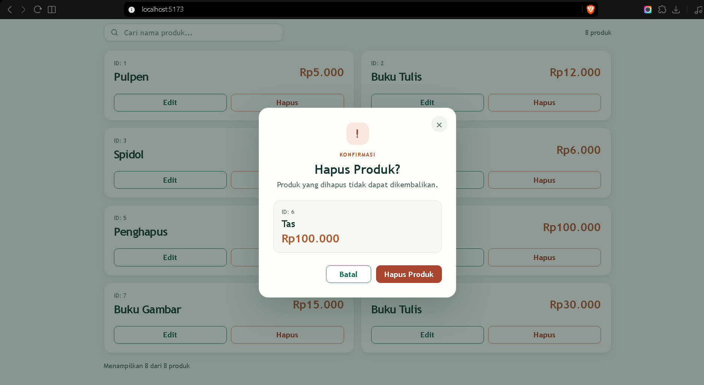

## Ringkasan Perubahan

Membuat website Manajemen Produk menggunakan React dan JavaScript.

Fitur yang dikembangkan meliputi:
- Menampilkan daftar produk beserta ID, nama, dan harga.
- Pencarian produk berdasarkan nama.
- Menambahkan produk baru melalui popup.
- Mengedit informasi produk melalui popup.
- Menghapus produk melalui konfirmasi popup.

## Bukti Pengujian

| Skenario | Hasil yang Diharapkan | Hasil Aktual |
|---|---|---|
| Membuka halaman Manajemen Produk | Daftar produk ditampilkan | Sesuai |
| Mencari produk berdasarkan nama | Produk yang sesuai ditampilkan | Sesuai |
| Menambahkan produk | Produk baru masuk ke daftar | Sesuai |
| Mengedit produk | Informasi produk berhasil diperbarui | Sesuai |
| Menghapus produk | Produk berhasil dihapus dari daftar | Sesuai |

## Dokumentasi

